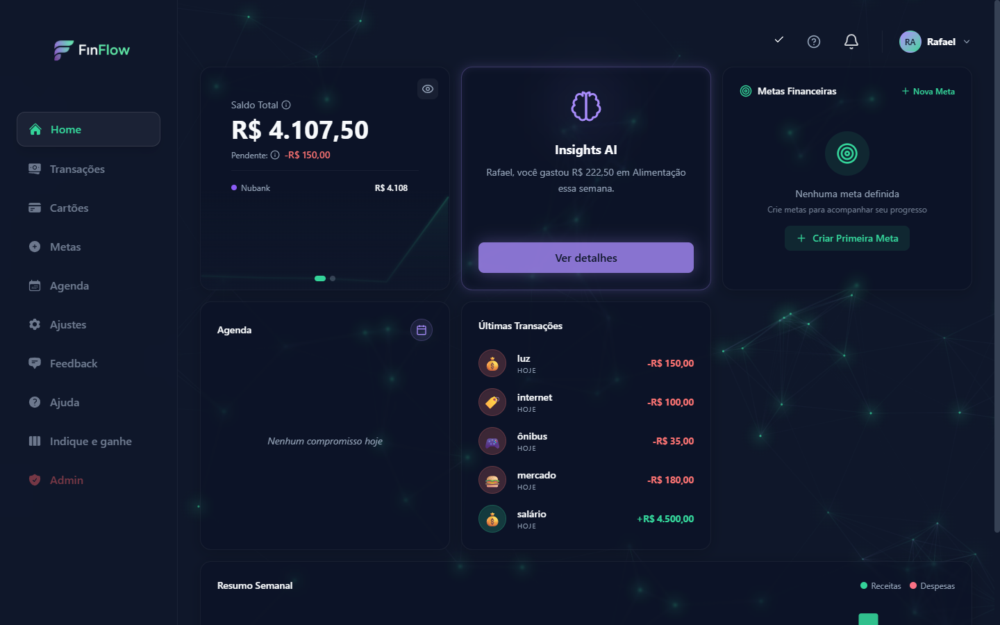
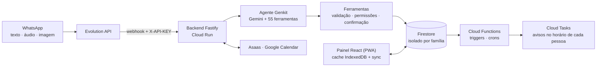
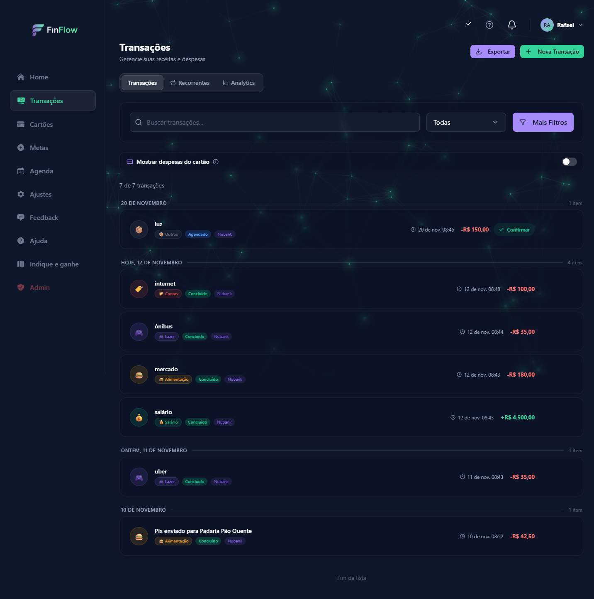
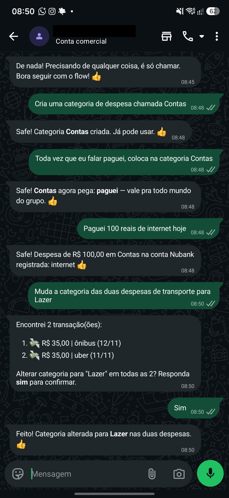
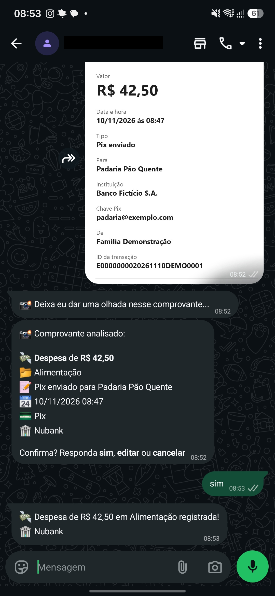
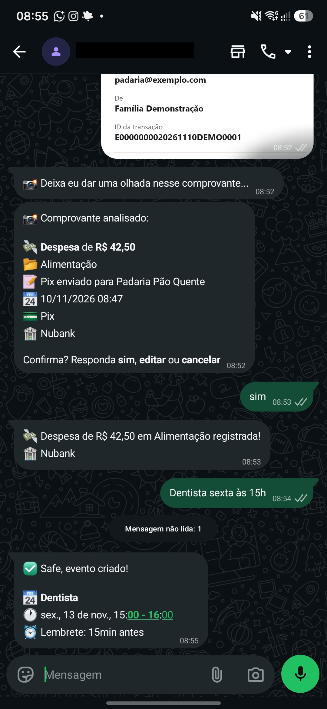
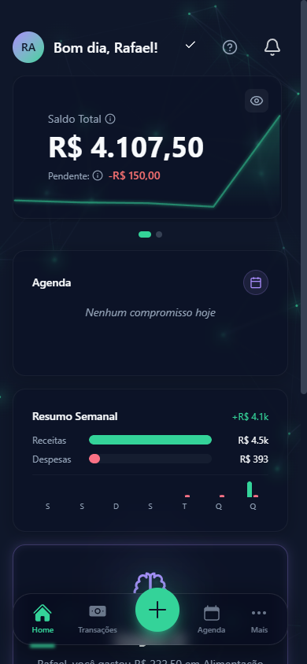

# FinFlow

**Finanças da família e agenda pelo WhatsApp, com um agente de IA que só confirma o que de fato executou.**

SaaS brasileiro em produção, com clientes pagantes. A pessoa escreve, manda áudio ou foto de comprovante no WhatsApp e o agente registra despesas, contas a pagar, cartões, metas e compromissos. Um painel web (PWA) mostra o mesmo estado para revisar, organizar e planejar.



<sub>Todas as telas usam uma família de demonstração com dados fictícios. O código-fonte é privado. Os trechos abaixo são simplificados.</sub>

---

## Resumo

| | |
|---|---|
| **Problema** | Controle financeiro morre porque registrar dá trabalho. Planilha e app exigem disciplina, mas mandar mensagem no WhatsApp a pessoa já faz |
| **Meu papel** | Fundador. Produto, arquitetura, desenvolvimento full stack, operação, suporte e cobrança, conduzidos com agentes de IA |
| **Stack** | TypeScript · Node.js · Fastify · Genkit + Gemini · Firestore · Cloud Run · Cloud Functions · Cloud Tasks · React + Vite (PWA) · Zustand · Dexie · Asaas · Google Calendar |
| **Escala** | 589 commits em 10 meses · 55 ferramentas do agente · 97 arquivos de teste · ~140 mil linhas de TypeScript |
| **Estágio** | Em produção desde janeiro de 2026, com assinaturas pagas via Pix, boleto e cartão |

**Destaques**

- **Custo unitário medido em produção:** cerca de R$ 0,05 de IA por mensagem, ~8% do ticket numa família típica, e as decisões de infraestrutura que mantêm esse número baixo. [→ Decisão de base](#decisão-de-base-infraestrutura-proporcional-ao-estágio)
- **Um agente que não confirma o que não fez:** regras nas ferramentas, prévia e confirmação sobre o mesmo conjunto, personalização com precedência definida. [→ Decisões técnicas](#decisões-técnicas)
- **Dinheiro contado uma vez só:** meta como reserva de saldo, cartão como obrigação, idempotência que cobre todos os efeitos da cobrança.
- **Testes para um sistema não determinístico:** corpus de regressão do agente, Security Rules testadas contra o emulador e validação pelo estado gravado. [→ Testes](#como-testo-um-agente-que-não-é-determinístico)
- **Operação real:** o postmortem das 22 horas em que o bot ficou fora do ar sem ninguém perceber. [→ Operação](#operação-o-dia-em-que-o-bot-ficou-mudo-por-22-horas)

## Contexto

Fazer um modelo de linguagem entender "gastei 50 no mercado" é a parte fácil. O difícil é que **o modelo interpretou, a ferramenta executou e o usuário leu** são três coisas diferentes, e num produto financeiro elas precisam coincidir. Um bot que responde "registrado!" sem gravar, que altera 20 linhas depois de mostrar 18 ou que conta duas vezes o mesmo dinheiro perde a confiança do usuário na primeira vez.

Por isso a regra de negócio fica nas ferramentas, não no prompt. O modelo escolhe a intenção e preenche os parâmetros. Quem valida, calcula, aplica permissões e decide o que pode ser gravado é o código.

## Arquitetura



Três fronteiras orientam o resto do sistema:

- **Multi-tenant por família.** Todo dado vive em `families/{familyId}/…`, e as Security Rules do Firestore bloqueiam acesso cruzado independentemente do backend. As Rules têm suíte própria, que roda contra o emulador.
- **O agente propõe, a ferramenta decide.** Cada ferramenta devolve erros estruturados (`DUPLICATE_RECENT`, `LIKELY_TEACHING`, …), e o fluxo de chat tem guardas para resposta de sucesso sem chamada de ferramenta, com nova tentativa e fallback de modelo.
- **Painel local-first.** O PWA guarda transações, eventos e cadastros em IndexedDB e sincroniza só o que mudou desde a última visita, com fila para operações feitas offline.

## Decisão de base: infraestrutura proporcional ao estágio

No início, a pergunta principal era de negócio, não técnica: alguém usa isso todo dia e paga por isso? A infraestrutura precisava permitir validar com custo próximo de zero, sem servidor para operar, e sem virar um teto se a resposta fosse sim.

O preço reforça essa restrição. O FinFlow custa **R$ 19,90 por mês, ou R$ 29,90 para uma família de até 5 pessoas**, e o custo de cada mensagem decide se a margem existe. Custo unitário é requisito de produto, não otimização para depois.

Medido nos logs de produção de outubro e novembro de 2026: cada mensagem custa em média **US$ 0,008 (cerca de R$ 0,05) em IA**. Uma família típica, com 33 mensagens no mês, fica perto de **R$ 1,50, ou ~8% do ticket**. As mais ativas chegam a ~25%. A IA é o maior custo variável do produto, e é por isso que as decisões abaixo existem.

| Escolha | Por quê | O preço que aceitei | Como compensei |
|---|---|---|---|
| **Firestore (NoSQL)** | O free tier cobre a fase de validação. Auth, Security Rules, persistência offline e triggers vêm prontos | Dado financeiro é relacional. Somar o mês, agrupar por categoria ou cruzar conta com período seria um `SUM … GROUP BY` em SQL | Documentos de resumo mantidos por trigger, e cache local no painel com sincronização incremental, para não reler o que não mudou |
| **Cloud Run com zero instâncias mínimas** | Sem tráfego, custo zero | Cold start de alguns segundos na primeira requisição depois de um período ocioso, no WhatsApp e no painel | Backend em Fastify, escolhido pela inicialização rápida, e painel que abre pelo cache local (abaixo) |
| **Escala gerenciada** | Cloud Run, Cloud Functions e Cloud Tasks escalam sozinhos | Menos controle fino do que numa VM própria | Hoje: até 10 instâncias × 80 requisições simultâneas. Subir o teto é mudar uma flag, sem migração |
| **Modelo leve por padrão** | Gemini Flash-Lite atende a maior parte das mensagens e dos comprovantes pelo menor custo por token | Modelos leves erram mais em instruções longas | Regras críticas ficam no código das ferramentas. O modelo maior entra só como fallback quando o leve falha, e a telemetria conta quantas vezes |
| **WhatsApp pela Evolution API, em VM gratuita** | A API oficial cobra pelas mensagens que a empresa inicia e exige template aprovado para cada uma. Lembretes e resumos diários pesariam muito num ticket de R$ 19,90 | Integração não oficial: o número pode ser desconectado ou bloqueado, e uma desconexão já tirou o bot do ar. Também é um servidor a mais, sem redundância | Isolada atrás de webhook com chave e trocável por variável de ambiente, sem mudar código. Migrar para a API oficial é o plano quando a receita cobrir o custo por mensagem |

**O custo do NoSQL, pago no design.** O Firestore cobra por documento lido. Abrir o painel e somar todas as transações da família faria cada visita custar proporcionalmente ao histórico. Por isso o trigger `onTransactionWrite` mantém `stats/current` e `stats/monthly-{YYYY-MM}` a cada escrita. Ele calcula a diferença entre o antes e o depois do documento e separa saldo disponível (concluído) de pendente (agendado ou vencido). O painel lê um documento em vez de centenas.

Num banco relacional isso seria uma consulta com índice. Aqui virou código a manter: edição, exclusão, mudança de status e troca de conta precisam ajustar o resumo corretamente, e o resumo é atualizado de forma assíncrona. Foi uma troca consciente: complexidade de engenharia em vez de custo fixo, numa fase em que o custo fixo pesava mais.

**Cold start nos dois canais.** Com zero instâncias, a primeira requisição depois de um período ocioso espera alguns segundos enquanto o Cloud Run sobe o contêiner. No WhatsApp o atraso pesa menos, porque a pessoa manda a mensagem e segue o que estava fazendo. No painel pesa mais, e a mitigação é o cache local: quem volta vê na hora o último estado salvo, enquanto a sincronização espera o backend acordar. A primeira visita, sem cache, ainda sente o atraso. A saída é conhecida e tem preço: uma instância mínima elimina o cold start em troca de custo fixo mensal, que passa a valer quando a base pagante cobrir esse custo.

**O custo que mais pesa é o da IA.** Cada mensagem envia ao modelo cerca de 23 mil tokens de entrada na mediana (instruções, dados da família e esquemas das ferramentas), e cada rodada de chamada de ferramenta paga esse prefixo de novo. Perto disso, as leituras do Firestore são troco. Três mecanismos atacam esse custo:

- **Só as ferramentas do assunto.** `classifyToolGroups` envia ao modelo apenas os grupos de ferramentas relevantes à mensagem, não as 55. Se o modelo pedir uma ferramenta que ficou de fora, a chamada é refeita uma vez com o registro completo.
- **Consumo medido por família.** Toda mensagem registra tokens de entrada, de saída e servidos do cache, por modelo. O trial tem cota diária de tokens.
- **Cache de prompt calculado, não presumido.** O cache implícito do Gemini quase não era aproveitado entre mensagens, por causa da ordem do prompt. O explícito ainda não se paga com a frequência de uso atual. Reordenar o prompt é a próxima otimização, com estimativa de ~40% a menos no custo de entrada.

<details>
<summary><b>Detalhe: as contas do cache de prompt</b></summary>

**Implícito, que não custa nada para manter.** A documentação interna afirmava que ele já reduzia a fatura. Quando passei a registrar os tokens servidos do cache, a medição mostrou outra coisa: o desconto vinha quase todo de dentro da mesma mensagem, e entre mensagens o aproveitamento ficava entre 0% e 23%. A causa provável é a ordem do prompt, porque os dados da família ficam no meio dele e quebram o prefixo comum. Movê-los para o fim deixaria cerca de 11 mil tokens idênticos para todas as famílias, cobrados a 10% do preço. Isso a confirmar com mais amostras.

**Explícito, que só vale quando se paga.** O cache explícito garante o desconto em troca de uma taxa por hora para mantê-lo vivo. Com o 3.1 Flash-Lite, manter o cache custa cerca de US$ 1 por milhão de tokens por hora, e cada leitura economiza 90% do preço de entrada. Ele só compensa a partir de **~4,4 leituras por hora**, sustentadas enquanto o cache estiver vivo. Quem decide isso é a frequência de uso dos próprios usuários, não o total do mês: as pessoas lançam em rajadas, depois de uma compra ou ao conferir o saldo de manhã. Nos últimos 30 dias, só **22% das horas tiveram alguma mensagem**, e só **8% chegaram ao ponto de equilíbrio**. Nas outras horas, o cache seria pago para ficar ocioso.

Há também uma restrição estrutural: o cache congela o conjunto de ferramentas, e como o filtro por assunto gera combinações diferentes, cada combinação precisaria de um cache próprio. Por isso a ordem é aproveitar primeiro o implícito e ligar o explícito quando o uso passar do ponto de equilíbrio.

</details>

**Quando eu mudaria.** Os gatilhos para levar o núcleo financeiro a um banco relacional são dois: o custo de leitura do Firestore passar o de uma instância PostgreSQL gerenciada, ou relatórios com recortes livres (categoria × conta × período escolhido pelo usuário) exigirem mais documentos de resumo do que vale manter. A estrutura já ajuda essa migração: tudo vive sob `families/{familyId}`, o que se traduz direto numa coluna `family_id`.

---

## Decisões técnicas

### 1. A família ensina a categoria, sem mudar o produto para os outros

**Problema.** Categoria errada era a principal queixa de quem cancelava. Num pequeno comércio que usa o FinFlow com funcionários, um deles pediu: *"toda vez que eu falar paguei, coloca em Contas"*. O bot concordou e esqueceu, porque a memória de conversa é curta e não existia operação para guardar uma preferência. Na semana seguinte, a família corrigiu à mão o que o modelo classificou por significado.

**Decisão.** Uma regra global resolveria aquele cliente e estragaria a organização de todos os outros. As regras passaram a ser **por família e gravadas na própria categoria**. O documento já é lido em toda mensagem, então a regra não custa leitura extra, não pede Security Rule nova e some junto com a categoria.

A aplicação segue uma escada, do mais específico ao mais geral:

1. Categoria dita na frase vence qualquer regra ("paguei o aluguel, põe em Moradia").
2. Texto ensinado encontrado **literalmente na mensagem original**. A checagem roda no código, porque "paguei" é um verbo que nunca chega à descrição que o modelo extrai.
3. Regra por membro ("tudo que o João mandar vai para Contas").
4. Regra semântica ("tudo que for fruta vai para Feira"): uma chamada auxiliar curta só pergunta se o item pertence ao grupo. Ela tem timeout de 8 s e, em caso de erro ou dúvida, grava como antes.

Na bateria de desenvolvimento, só o modelo principal acertou 3 de 6 frutas. Com a chamada auxiliar foram 8 de 8, e itens fora do grupo (parafuso, sabão, ração) continuaram sem categoria.

**O efeito colateral.** A frase de ensinar tem o mesmo formato de uma correção ("coloca isso em Contas"), e o agente reescrevia a última transação. A instrução no prompt perdeu para o modelo mais barato, então a ferramenta de correção passou a recusar com `LIKELY_TEACHING` quando a mensagem traz um marcador de permanência ("toda vez", "sempre que").

<table>
<tr>
<td width="34%"></td>
<td width="66%"></td>
</tr>
<tr>
<td><sub>A regra é ensinada na conversa e vale para todo o grupo</sub></td>
<td><sub>O painel mostra o resultado: internet em Contas, a luz ainda agendada</sub></td>
</tr>
</table>

### 2. A confirmação altera exatamente o que a prévia mostrou

**Problema.** Operações em lote ("muda a categoria das despesas de transporte para Lazer") mostram uma prévia e esperam um "sim". Em teste, a prévia listou 18 despesas e a confirmação gravou nas 20 linhas da busca, carimbando categoria de despesa em duas receitas. Os dois caminhos filtravam de formas diferentes, e outro corte fazia a prévia mostrar 10 itens enquanto o "sim" alterava 20.

**Decisão.** Prévia e confirmação passaram a usar a mesma função de estreitamento (`narrowToFilters`). Tipo, valor e data são filtros rígidos, e um índice dito pelo usuário vence qualquer filtro inferido pelo modelo. Quando a busca atinge o limite de varredura, a resposta diz "ao menos N" em vez de prometer um total que o sistema não conhece.

**Como validei.** O teste de regressão não verifica a mensagem de sucesso. Ele compara as linhas gravadas com as que deveriam ficar intactas, e falha sem a correção.

<table>
<tr>
<td width="34%"></td>
<td width="66%">

**A lista que o usuário viu é a verdade.** A causa raiz recorrente desse tipo de bug era refazer a busca na hora de confirmar. Hoje a confirmação parte do conjunto exibido, aplica os mesmos filtros e só então grava.

O salário e as demais despesas da tela de transações acima continuaram com as categorias originais.

</td>
</tr>
</table>

### 3. Guardar dinheiro na meta não é receber dinheiro

**Problema.** "Guardei 400 na meta da viagem" virava uma receita vinculada à meta. O dinheiro já estava na conta e passava a ser contado duas vezes.

**Decisão.** A meta passou a ser uma **parte nomeada do saldo**. Reservar e liberar geram movimentos próprios (`goals/{id}/movements`) e atualizam o valor da meta na mesma transação do Firestore, sem criar transação nem alterar os totais. Receitas e despesas realmente vinculadas a uma meta continuam movendo saldo e meta. A consulta de saldo mostra quanto dele está reservado.

O mesmo princípio vale para o cartão de crédito. A compra é uma obrigação que entra na fatura, e só o pagamento da fatura é saída de caixa. Tratar as duas como despesas independentes dobraria os gastos do mês.

### 4. Lançar sem ver o caixa

**Problema.** Um cliente com comércio queria que funcionários registrassem vendas e gastos sem enxergar saldo, relatórios nem lançamentos dos outros.

**Decisão.** Um quinto papel, **Operador**, com `canViewReports: false`. O desafio não é esconder um card no painel, e sim garantir que nenhum caminho revele valores: resposta do agente, notificação automática, relatório exportado. Duas regras sustentam isso:

- **Um único helper (`canSeeMoney`) com fail-open para campo ausente.** Só nega quando a permissão é explicitamente `false`. Assim, documentos antigos e objetos de permissão parciais não viram regressão para quem já usava o produto.
- **Leitura escopada por autoria nas Security Rules.** O Operador só lê transações com `userId` igual ao dele. Como o Firestore avalia a query, e não cada documento, toda consulta do painel desse papel precisa filtrar por `userId`.

### 5. Cobrança: evento repetido e evento atrasado

A cobrança da assinatura roda por webhooks do Asaas, e cada um deles produziu um bug que custava dinheiro ou confiança:

- **Evento atrasado.** No cartão, o Asaas envia `PAYMENT_CONFIRMED` na cobrança e `PAYMENT_RECEIVED` na liquidação, cerca de 32 dias depois. O evento de liquidação chegava após a cobrança do ciclo seguinte e recalculava o vencimento a partir do ciclo antigo, **expirando clientes que estavam pagando**. A correção é uma guarda monotônica: nenhum evento pode mover o vencimento para trás.
- **Evento repetido.** A idempotência (registro do evento dentro de uma transação do Firestore) já impedia reprocessar a assinatura, mas o aviso de cobrança no WhatsApp e o log de auditoria rodavam depois dela, sem condição. Um cliente recebeu o mesmo aviso duas vezes, com 24 s de intervalo.

```ts
let firstDelivery = false

await db.runTransaction(async (tx) => {
  firstDelivery = false                       // a transação pode ser reexecutada
  if ((await tx.get(eventRef)).exists) return // entrega repetida
  tx.create(eventRef, { eventId, processedAt, expiresAt: ttl90days })
  firstDelivery = true
  // ... atualiza a assinatura, nunca recuando expiresAt
})

if (firstDelivery && event === 'PAYMENT_OVERDUE') notifyOverdue(family)
```

Idempotência precisa cobrir **todos os efeitos** do fluxo, não só a escrita principal. Em desenvolvimento, o mesmo evento enviado duas vezes passou a gerar 1 mensagem e 1 auditoria (antes eram 2 e 2).

---

## Outras entradas: foto e agenda

Comprovantes passam por um fluxo de visão, que extrai valor, tipo, destinatário e data e **mostra uma prévia antes de gravar**. Compromissos viram eventos com lembrete, sincronizados com o Google Calendar e avisados pelo WhatsApp no fuso da família.

<table>
<tr>
<td width="36%"></td>
<td width="36%"></td>
<td width="28%"></td>
</tr>
<tr>
<td><sub>Comprovante (fictício): prévia e confirmação</sub></td>
<td><sub>"Dentista sexta às 15h" vira evento com lembrete</sub></td>
<td><sub>O mesmo estado no painel móvel</sub></td>
</tr>
</table>

## Como testo um agente que não é determinístico

A mesma mensagem pode gerar respostas diferentes. Por isso o que precisa ser exato fica no código, onde se testa como qualquer função, e o comportamento do modelo é medido contra casos fixos.

- **Corpus de regressão do agente.** São 85 intenções, cada uma com a mensagem do usuário (às vezes em vários turnos, com dados preparados antes), a ferramenta esperada e os parâmetros que precisam sair dela: "gastei 50 no mercado" tem de chamar `createExpense` com `amount: 50`. O corpus nasceu como linha de base antes de reescrever o prompt e ganha casos novos a cada correção de comportamento.
- **Temperatura 0 e guardas no código.** Erros estruturados, checagem de duplicata recente e detecção de "sucesso" sem chamada de ferramenta não dependem do modelo obedecer ao prompt.
- **Lógica de domínio com testes unitários.** Cerca de 60 arquivos cobrem ferramentas e bibliotecas: resolução de categoria, projeção de recorrências, âncora de datas, filtros de lote.
- **Security Rules testadas contra o emulador**, incluindo a leitura escopada do Operador. A cópia das regras de permissão que roda nas Cloud Functions tem teste de paridade com a original.
- **Ponta a ponta com WhatsApp real, isolado.** Um número de desenvolvimento e um proxy de captura permitem exercitar o fluxo inteiro sem tocar clientes. O critério de aprovação é o estado gravado no banco, não a frase do bot.

## Operação: o dia em que o bot ficou mudo por 22 horas

| | |
|---|---|
| **Impacto** | Em 08 e 09/06/2026, todas as mensagens receberam "😕 Desculpe" durante 22 horas |
| **Causa** | O saldo pré-pago da API do Gemini zerou |
| **Por que o fallback não salvou** | A troca para o modelo maior usava a mesma chave e o mesmo saldo, então falhava junto |
| **Por que ninguém viu** | O erro estava nos logs, mas nada lia os logs. Não havia alerta |
| **Correção** | Alerta no Cloud Monitoring disparado pelo próprio log da falha, com no máximo um aviso a cada 30 minutos, e um script que confere se o canal de notificação está verificado. Canal não verificado não envia nada, e o alerta vira decoração |

Ficaram duas lições. **Um fallback só protege se não compartilha o domínio de falha do principal.** E **um alerta só existe se alguém confere que ele dispara.** O mesmo princípio vale para o deploy: uma vez, o Cloud Run subiu uma imagem antiga em silêncio, porque o pipe no comando de build escondia o código de saída. Desde então, cada deploy é conferido pelo comportamento da revisão nova, não pela saída do comando.

## Segurança e LGPD

- **Isolamento em duas camadas.** O backend filtra toda consulta pela família, e as Security Rules bloqueiam o acesso cruzado mesmo que o backend erre.
- **Permissões no token.** Família e papel viajam como custom claims no JWT. As Rules decidem sem ler documento extra, o que é mais rápido e mais barato, e só consultam o banco como fallback.
- **Entradas autenticadas.** Webhooks do WhatsApp exigem chave no cabeçalho, e os do Asaas exigem token, com idempotência transacional. A API usa `helmet` e rate limit de 200 requisições por minuto por IP.
- **Direitos do titular.** A exclusão de conta acontece só pelo painel e fica bloqueada enquanto houver assinatura ativa, para não deixar cobrança órfã. O usuário exporta seus dados em CSV, PDF e Excel, e as ações sensíveis ficam em log de auditoria com retenção de 90 dias.
- **Privacidade até no painel administrativo.** O admin vê contagens e agregados, nunca valores de transação. Telefones são mascarados nos logs, e toda ação do admin é auditada.

## Como trabalho com agentes de IA

Desenvolvo com agentes de IA. Eu defino as regras de negócio, avalio as propostas técnicas e valido as entregas. Trato o que o agente produz como um pull request a revisar, não como resposta pronta:

- **Telemetria do agente em produção.** Contadores de chamadas de ferramenta, erros por código, novas tentativas, fallback de modelo e duplicatas bloqueadas, por família e no total, exibidos num painel administrativo.
- **Causa antes de correção.** Ao comparar o relatório de outra IA com os dados de produção, o sintoma estava certo e a causa não: uma falha atribuída às tarefas assíncronas era um índice ausente no Firestore.
- **O teste precisa falhar sem a correção.** A massa de teste reproduz a forma dos dados de produção. Um teste que passa com e sem o conserto não prova nada.

## O que eu faria diferente

- **Medir desde o primeiro dia.** A telemetria do agente veio em abril. Atividade por família, custo por interação e taxa de operações corrigidas deveriam ter nascido junto com o produto.
- **Um portão de qualidade automático antes do deploy.** Hoje há hook de pre-commit, o deploy é manual e o corpus de regressão roda fora de um pipeline. Eu colocaria typecheck, testes e o corpus como avaliação do agente num CI que bloqueia o deploy quando algo regride.
- **Uma única fonte de verdade para cada cálculo.** Durante um tempo, o saldo por conta era calculado pela ferramenta e reexplicado no prompt, e as duas versões divergiram. Hoje o número vem só da ferramenta e o modelo apenas o apresenta.
- **Modelar o domínio financeiro antes das telas.** Cartão como livro separado, metas como reserva e recorrências projetadas versus materializadas chegaram por correção. Definidos no início, teriam evitado migrações.

## O que aprendi

- **Controlar um agente é validar o que ele executa, não o que ele responde.** As garantias moram nas ferramentas, com erros estruturados que o fluxo sabe tratar.
- **Personalização é regra de produto, não memória de conversa.** O que o usuário ensina precisa ser persistido, ter escopo e ter precedência definida.
- **Toda garantia tem um efeito colateral.** A regra de categoria criou o risco de reescrever a última transação, e a idempotência da assinatura deixou de fora a notificação. Cada correção gerou um teste para a próxima.

---

<sub>[finflows.com.br](https://www.finflows.com.br/) · Repositório privado. Este estudo descreve decisões e mecanismos sem expor código ou dados de clientes.</sub>
