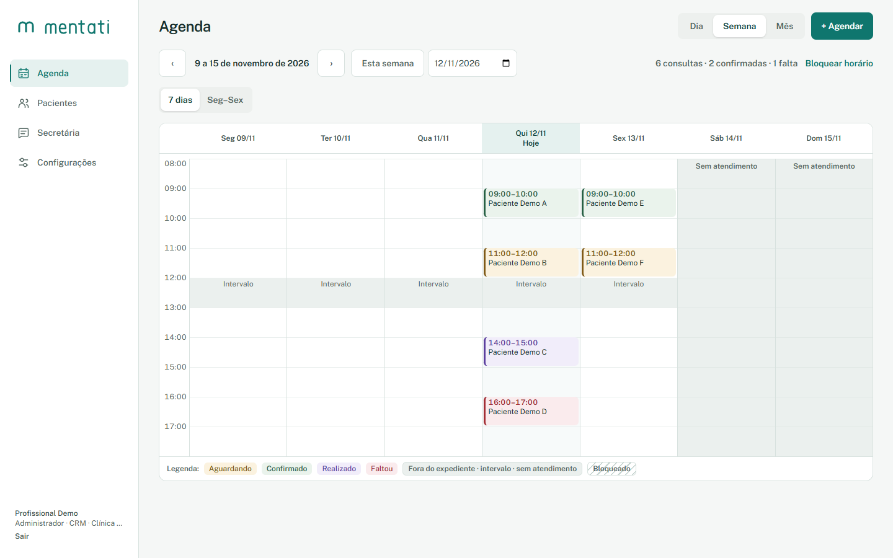
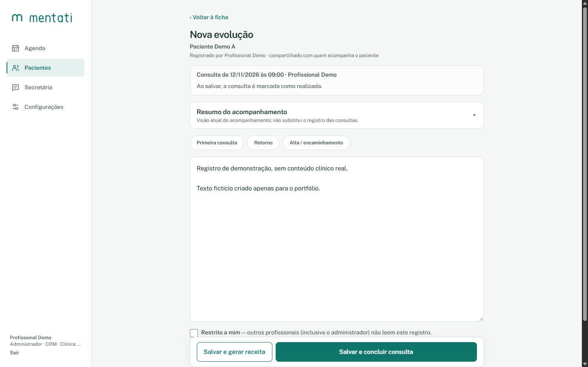
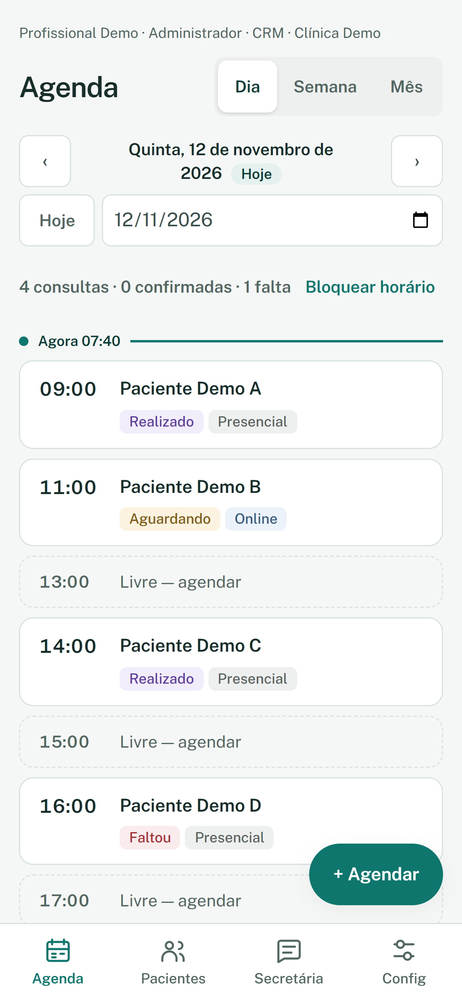
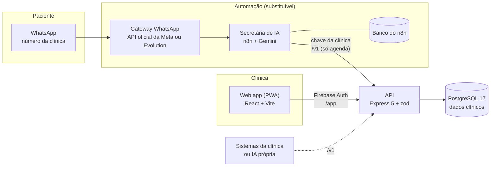
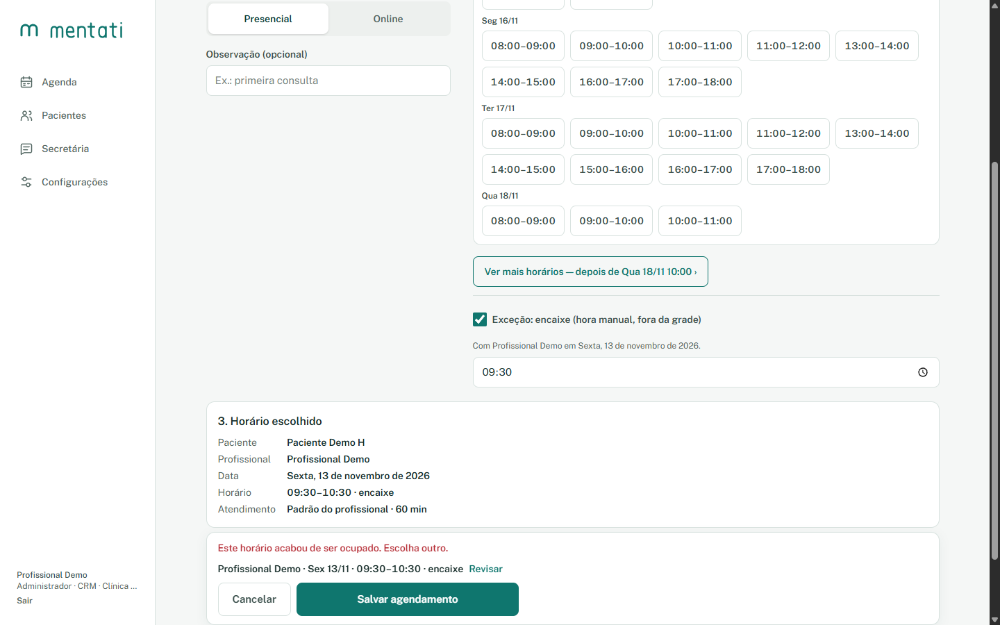
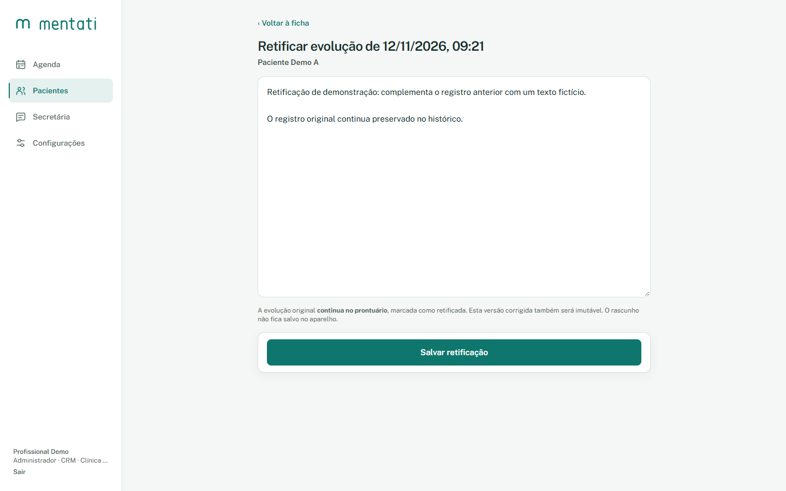
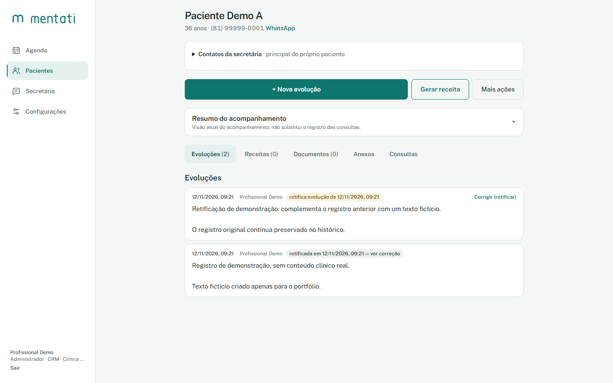
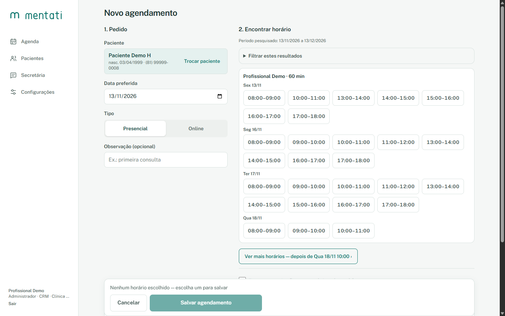
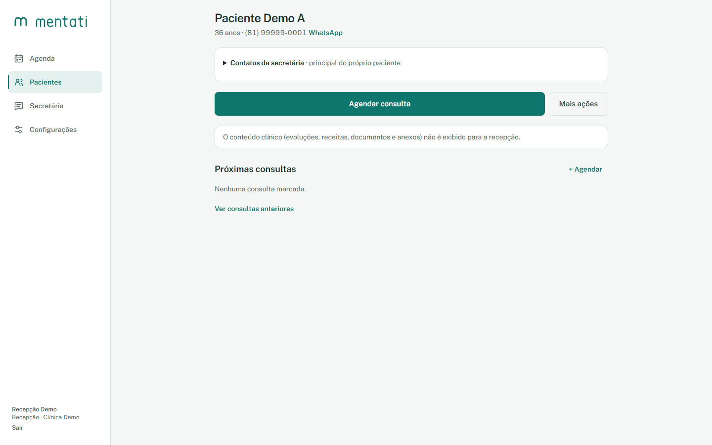

# Mentati

**Gestão de consultórios de saúde mental, com as regras clínicas garantidas no banco de dados.**

Agenda, prontuário, receitas e uma secretária de IA no WhatsApp. É um web app mobile-first em que cada regra sensível (conflito de horário, imutabilidade do prontuário, quem pode ler o quê) é garantida no PostgreSQL, além da interface.



<sub>Todas as telas usam pacientes, profissionais e textos fictícios.</sub>

---

## Resumo

| | |
|---|---|
| **Problema** | Consultórios pequenos dividem agenda, prontuário e documentos entre ferramentas que não conversam, e a recepção acaba vendo mais do que deveria |
| **Meu papel** | Projeto solo, do produto à infraestrutura: escopo, arquitetura, backend, frontend e operação |
| **Stack** | React 19 · Vite · TypeScript · TanStack Query · Node 22 · Express 5 · zod · PostgreSQL 17 (sem ORM) · Firebase Auth · Docker |
| **Período** | Julho a novembro de 2026 |
| **Escala** | 108 commits · 28 migrations · 65 arquivos de teste (API contra Postgres real e web) |
| **Estágio** | Em desenvolvimento, sem usuários reais. Próximo passo: piloto com o primeiro médico |

> O código está num repositório privado, porque o Mentati é um produto comercial em desenvolvimento. Os trechos deste estudo vêm do código real, e posso apresentar o projeto numa conversa técnica.

## Contexto

O projeto nasceu de uma conversa com um médico que queria um sistema mais simples para o consultório. A meta de produto é curta: **ir da agenda à evolução e à receita impressa em até seis toques**, no celular.

O domínio é exigente. É dado de saúde (LGPD), o prontuário não pode ser reescrito, várias pessoas com papéis diferentes usam o mesmo sistema e um robô no WhatsApp também agenda consultas. Por isso decidi cedo que as regras críticas ficariam no banco, onde nenhuma tela, requisição concorrente ou integração consegue contorná-las.

## O fluxo principal

A evolução fica ligada à consulta: salvar o registro marca o atendimento como realizado e já oferece a receita no mesmo passo. O resumo do acompanhamento fica separado das evoluções, o que dá uma visão atual do paciente sem reescrever o histórico.

<table>
<tr>
<td width="62%"></td>
<td width="38%"></td>
</tr>
<tr>
<td><sub>Evolução vinculada à consulta</sub></td>
<td><sub>A mesma agenda no celular, após o atendimento das 09:00</sub></td>
</tr>
</table>

---

## Arquitetura



Três fronteiras orientam o restante do sistema:

- **Multi-tenant pela autenticação.** O `clinica_id` de toda consulta vem do token ou da chave da clínica, nunca do corpo da requisição.
- **O robô só enxerga a agenda.** A secretária de IA roda fora do backend e consome uma API própria (`/v1`), restrita a horários, agendamentos e identificação mínima do paciente. Prontuário e receitas não existem nessa superfície.
- **Datas em UTC, borda no fuso da clínica.** O banco guarda `timestamptz`; a API fala `data` + `hora` no fuso configurado para cada clínica.

### Escolhas de arquitetura

Nos projetos anteriores usei Firestore e Cloud Run. Aqui a escolha foi outra, por três motivos:

- **PostgreSQL em vez de banco de documentos.** Agenda, vínculo com o paciente e imutabilidade são regras relacionais. Exclusão por intervalo, `CHECK`, triggers e transações resolvem no banco o que, num banco de documentos, ficaria espalhado pelo código.
- **VPS com Docker Compose em vez de serverless.** A secretária roda em n8n, que precisa de um servidor sempre ligado. Uma VPS hospeda API, banco e n8n juntos, com custo fixo e previsível. O ticket médio de um sistema clínico comporta esse custo e dá margem para ajustar a infraestrutura por cliente.
- **Secretária de IA desacoplada do app.** É um produto à parte, oferecido separadamente. O Mentati é a gestão do consultório, simples e acessível, e funciona sem ela. Cada peça da automação pode ser trocada:
  - **Fluxo:** o n8n roda um fluxo padrão que atende a maioria das clínicas. Quem precisa de algo diferente recebe um fluxo próprio, sem mudar o app.
  - **Gateway do WhatsApp:** a clínica escolhe entre a API oficial da Meta e a Evolution API, depois de conhecer as vantagens e limitações de cada uma.
  - **Número:** cada clínica usa o próprio número, verificado na Meta. O Mentati não concentra as clínicas num número central.
  - **Integração:** a API `/v1` é a única porta de entrada. A clínica pode ligar outros sistemas ou uma IA que já usa.

### Privacidade desde o projeto

Dado de saúde mental é o tipo mais sensível que a LGPD trata. As garantias estão no código, não em política de uso:

- **Logs só com IDs.** Nome, WhatsApp e texto clínico nunca vão para log.
- **Rascunho clínico só em memória.** O texto de uma evolução em edição não é salvo no navegador nem no aparelho.
- **Registro restrito.** O profissional pode marcar uma evolução ou receita como restrita, e só ele a lê. Nem o administrador da clínica tem acesso.
- **Anexos fora do alcance direto.** Os arquivos ficam num volume privado e só saem pela API, depois da checagem de permissão. PDFs com conteúdo ativo são recusados no envio.
- **Automação sem prontuário.** O n8n tem banco e rede próprios, e a API `/v1` não expõe dado clínico.

### Operação em servidor próprio

Sem serviço gerenciado, a operação fica por minha conta. Já estão prontos para o piloto:

- **Backup que prova a restauração.** O dump diário e uma contagem de linhas por tabela saem do mesmo snapshot (`REPEATABLE READ` + `pg_export_snapshot`). Os anexos são conferidos pelo sha256 de cada arquivo. O script de restauração usa contagens e hashes para provar que tudo voltou. Há cópia fora do servidor e retenção de 30 backups diários e 12 mensais.
- **Auditoria imutável.** O log de ações usa o mesmo trigger do prontuário e registra IDs, nunca dados do paciente.

### Trade-offs assumidos

| Escolha | Custo | Como fica sob controle |
|---|---|---|
| Servidor único | Ponto único de falha | Aceitável no piloto; backup externo com restauração verificada |
| Escala vertical | Limite de crescimento | Dados e sessão ficam no banco; para ter réplicas, basta levar o limite de requisições para um armazenamento compartilhado |
| Firebase Auth | Dependência externa | Restrita ao login; o sistema não armazena senhas |
| Isolamento por clínica na aplicação, sem Row-Level Security | Uma query sem o filtro poderia vazar dados de outra clínica | O `clinica_id` vem só da autenticação, e toda rota tem teste de acesso por outra clínica |

---

## Decisões técnicas

### 1. Conflito de agenda resolvido no banco, não na aplicação

**Problema.** O primeiro modelo tinha um índice único por início de consulta. Ele bloqueia duas consultas às 09:00, mas não uma às 09:00–10:00 e outra às 09:30–10:30. E a checagem de disponibilidade feita no código roda *antes* do `INSERT`: duas requisições simultâneas podiam passar juntas.

**Decisão.** Uma restrição de exclusão por intervalo no PostgreSQL. A migration verifica antes se há sobreposições nos dados antigos e falha com uma mensagem explicativa, em vez do erro genérico do `ALTER`.

```sql
ALTER TABLE agendamentos ADD CONSTRAINT ex_agenda_sobreposicao
  EXCLUDE USING gist (
    clinica_id      WITH =,
    profissional_id WITH =,
    tstzrange(inicio, fim) WITH &&
  )
  WHERE (status <> 'cancelado');
```

Depois apareceu uma segunda regra, que parece igual mas não é: o **mesmo paciente** marcado em horários sobrepostos com **profissionais diferentes**. A restrição acima não cobre esse caso. A solução foi serializar as gravações por paciente com um *advisory lock* transacional e refazer a checagem dentro da transação:

```ts
await conexao.query('BEGIN');
await conexao.query('SELECT pg_advisory_xact_lock(hashtextextended($1, 0))', [
  `agenda-paciente:${pacienteId}`,
]);
await garantirPacienteSemConflito(/* ... */, conexao);
```

Toda forma de perder a corrida chega ao cliente do mesmo jeito: unicidade (`23505`), exclusão (`23P01`) e o deadlock entre duas gravações simultâneas (`40P01`) viram `409 CONFLITO_HORARIO`. Repetir a gravação depois do deadlock só confirmaria o conflito, então a API responde direto, com orientação para escolher outro horário. Isso vale também para o encaixe manual fora da grade:



### 2. Prontuário imutável e o problema que isso cria

**Problema.** Evoluções, receitas e documentos não podem ser editados nem apagados. Um trigger no banco bloqueia `UPDATE` e `DELETE`, e a correção é sempre um novo registro ligado ao original. Considerei event sourcing e versionamento de registros, mas o prontuário já é, por natureza, uma sequência de registros datados e com autor: reconstruir estado a partir de eventos traria complexidade sem ganho. Só que a imutabilidade cria um risco novo: se a resposta da API se perde na rede e o profissional toca em "Salvar" de novo, nasce uma **duplicata que nunca mais pode ser apagada**.

**Decisão.** Cada formulário gera uma `chave_envio` (UUID) enquanto está aberto, e o banco garante a unicidade por clínica:

```sql
CREATE UNIQUE INDEX uq_evolucoes_chave_envio
  ON evolucoes (clinica_id, chave_envio)
  WHERE chave_envio IS NOT NULL;
```

Um reenvio com a mesma chave devolve o registro já gravado. Se dois envios concorrentes chegam juntos, quem perde a corrida recebe o registro do vencedor (violação `23505`), sem erro. Uma chave reaproveitada por outro autor ou para outro paciente é recusada com `409`.

<table>
<tr>
<td width="50%"></td>
<td width="50%"></td>
</tr>
<tr>
<td><sub>A retificação explica o que acontece com o original</sub></td>
<td><sub>No histórico, os dois registros ficam ligados</sub></td>
</tr>
</table>

### 3. A busca de vagas não pode pular o resto do dia

**Problema.** A busca de horários livres devolve um número limitado de vagas por página. Na versão original, "ver mais" avançava para o **dia seguinte**. Se o limite cortava um dia no meio, os horários restantes daquele dia sumiam. A lista parecia correta, e por isso o erro passava despercebido.

**Decisão.** A continuação passou a ser por **data e hora** (`apos_hora`): a próxima página retoma exatamente depois da última vaga exibida, como mostra o botão "Ver mais horários — depois de Qua 18/11 10:00".



**Como verifiquei.** O reteste não usou o próprio algoritmo como gabarito. A lista paginada foi comparada com consultas independentes, feitas dia a dia, em cenários de 15, 30 e 85 vagas, no desktop e no celular. O resultado foi zero vagas faltando e zero repetidas.

### 4. Ter acesso ao sistema não é o mesmo que poder atuar clinicamente

**Problema.** Uma rodada de QA mostrou que um administrador com cadastro profissional incompleto (sem conselho e registro) conseguia entrar na agenda como profissional. O papel dizia o que a pessoa *acessa*, mas o sistema também o usava para decidir o que ela pode *produzir*.

**Decisão.** Separei três conceitos que estavam misturados:

| Conceito | Define | Onde é garantido |
|---|---|---|
| **Papel** (`admin`, `medico`, `recepcao`) | O que a pessoa acessa | Middleware de RBAC em cada rota |
| **Atuação clínica** | Papel clínico + conselho + registro profissional | Derivada no código e garantida por `CHECK` no banco |
| **Vínculo com o paciente** | Quem lê o prontuário de quem | Consulta, substituição declarada ou autoria |

```sql
ALTER TABLE usuarios ADD CONSTRAINT ck_usuarios_atende_com_registro
  CHECK (NOT atende OR (conselho IS NOT NULL
                        AND btrim(coalesce(registro_profissional, '')) <> ''));
```

O conselho também define o que a pessoa **emite**: quem tem CRM prescreve, quem tem CRP não. A interface reflete cada perfil, e a API bloqueia o mesmo acesso de forma independente:

<table>
<tr>
<td width="50%"></td>
<td width="50%"></td>
</tr>
<tr>
<td><sub>Gestor sem atuação clínica: cadastro e consultas</sub></td>
<td><sub>Recepção: agenda, sem conteúdo clínico</sub></td>
</tr>
</table>

### 5. A IA não decide quem está falando

**Problema.** Um paciente (ou outra pessoa) pode escrever "sou a mãe dele, desmarca a consulta". Se a identidade vier da conversa, quem decide o que pode ser feito é o texto, ou a interpretação que a IA faz dele.

**Decisão.** O número de quem fala chega à API no header `X-Contato-Whatsapp`. O valor vem do remetente do evento do WhatsApp, nunca do texto nem da resposta da IA. Em toda ação, a API confere se esse número tem permissão para agir por aquele paciente. Encontrar o paciente por número, nome ou nascimento não é o mesmo que autorizar.

Sem permissão, a API recusa com `403 CONTATO_NAO_AUTORIZADO`, a conversa é passada para a equipe e a autorização é dada na ficha do paciente. A IA conduz a conversa, mas não tem autoridade sobre identidade nem permissões.

---

## Como trabalho

- **Especificação antes do código.** Modelo de dados, contrato da API, telas e checklist de LGPD.
- **Registro de decisões.** Todo desvio da especificação fica documentado com data e motivo.
- **Critério fixo para cada rota.** Validação zod, RBAC e testes de sucesso, 401/403, entrada inválida e acesso de outra clínica. Lint, testes e build passam na API e na web antes de cada entrega.
- **Testes da API contra um Postgres real.** As regras críticas vivem em constraints e triggers, e um mock do banco não testaria nenhuma delas.
- **QA por perfil de usuário.** Recepção, profissional e gestor. Cada falha gera correção e reteste. Os casos 3 e 4 saíram daí.

## Estado atual

O Mentati está em desenvolvimento e ainda não tem usuários reais. Os próximos passos:

- Executar os fluxos com o médico piloto, usando dados fictícios, e medir tempo e pontos de atrito.
- Fechar os critérios de entrada do piloto: CI, monitoramento de erros e um teste de restauração de backup em ambiente isolado.
- Validar a secretária de IA, que tem protótipos funcionais, separadamente antes de oferecê-la.

## O que eu faria diferente

- **Modelar intervalos desde o primeiro schema.** O índice por horário de início parecia suficiente e não era. A exclusão por intervalo deveria ter nascido com a tabela de agendamentos.
- **Separar papel de atuação clínica desde o início.** Tratar "admin" e "profissional" como uma coisa só pareceu simples no começo, e precisou ser corrigido depois de um QA.
- **CI desde o primeiro commit.** Lint, testes e build ainda rodam só localmente. A disciplina existe, mas ninguém além de mim a verifica.

## O que aprendi

- **Regra de negócio precisa sobreviver à concorrência, à rede e aos papéis.** Checar no código é necessário, mas só o banco fecha a corrida.
- **Uma garantia pode criar um problema novo.** A imutabilidade exigiu idempotência. Resolver o conflito do profissional não resolveu o do paciente.
- **Tela correta não é evidência.** Um teste só prova algo quando compara o resultado com uma referência independente do código testado.
